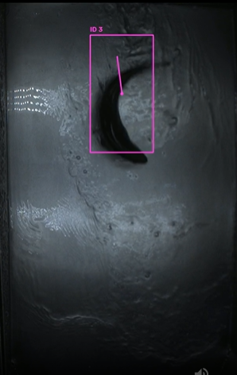
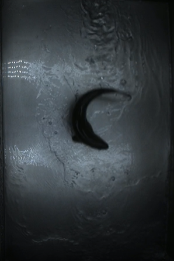
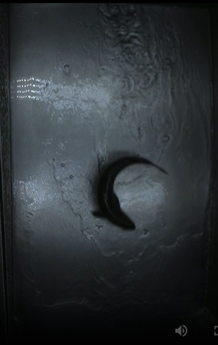
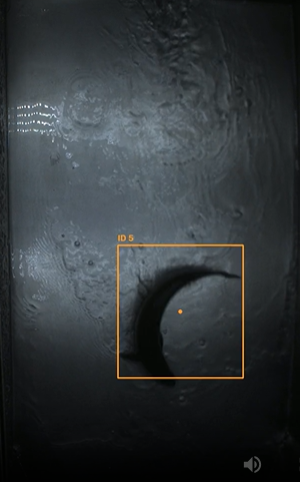

## Detección defectuosas

Hay casos con el modelo de detección actual de Yolo11.pt donde se salta/no detecta pescados en los fotogramas.

### Ejemplo Seq_0015:

- BOTSORT:  
*Frame86:* Detector va bien.  
  
*Frame87:* Detector no ve este, por lo que seguimiento tampoco.  
  
*Frame88:*  Detector de nuevo no detecta al pez.
  
*Frame89:* El detector por fin lo ve, y el seguimiento vuelve, pensando que es un pez nuevo.  
  

Las posibles causas son malas anotaciones, o entrenamiento defectuoso (revisar parametros de entrenamiento).